<!-- 01-title -->
<!-- _class: lead -->
<!-- _header: "" -->
<!-- _paginate: false -->

# Agentic AI for Research

**Congyue Cui · Lucas Sawade** · Princeton Research Computing · October 2026

<div class="logos"></div>

<!--
Notes:
Presenter names are placeholders; replace them before the talk.
Timing: 42 min, 35 slides. Natural split: sections 0-3 (slides 1-19) and 4-6 (slides 20-35); who takes which half is decided on the day. Handoff on slide 19.
-->

---

<!-- 02-bridge -->
<!-- _header: "0 · Bridge" -->

# You just watched it get built from nothing


<div class="cols">
<div>

1. The model landscape
2. Tokens, cost and delegation
3. Reviewing agent output
4. Setting up the workspace
5. Working patterns from your colleagues
6. Starter kit and discussion

</div>
<div>

<div class="callout"><b>Interrupt me.</b> Two of us are up here; the one not speaking is watching for your hand.</div>

<div class="callout"><b>Keep the build in mind.</b> We will point back at it: the retries, the unread diff, the missing AGENTS.md.</div>

</div>
</div>

<!--
Notes:
An hour ago you saw an agent build something from nothing; the rest of this session is how to supervise one.
Show of hands: "Who has run an agent on your own code before today?"
Then: "Who has merged something it wrote without reading all of it?" (expect a laugh; this plants section 3.)
Walk the six agenda items in one breath each; do not explain them yet.
Say the interrupt rule out loud; the co-presenter watches for hands.
Timing: 2 minutes.
-->

---

<!-- 03-model-vs-tool -->
<!-- _header: "1 · The model landscape" -->

# Model ≠ tool: you can swap either one

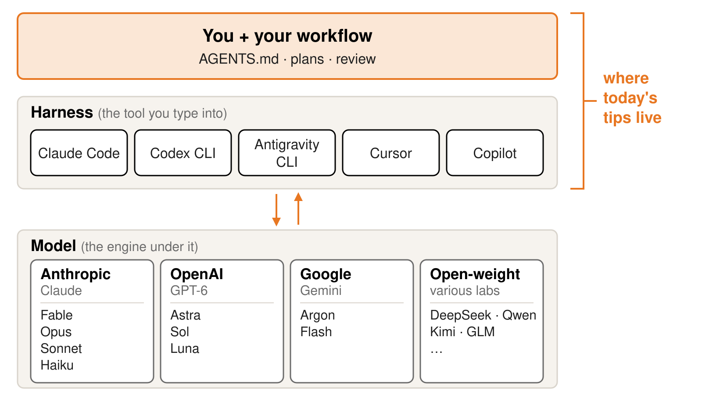

<p class="small center">Today's tips are about how you work, so they carry over to most tools and models.</p>

<!--
Notes:
The harness is the program you type into: it reads files, runs commands, asks permission. The model is the engine it calls.
They are separate choices: Cursor and Copilot offer a model picker; Claude Code lets you switch between Claude tiers.
Google's Gemini CLI is now Antigravity CLI: consumer sign-in ended 18 Jun 2026; Gemini CLI still runs on paid API keys and enterprise licenses.
Last talk you saw one model inside one tool; that was one cell of this picture, not the whole thing.
Point at the bracket: AGENTS.md, plans and review are yours, and they move with you when the tool or model changes.
About 1 minute. Model names on the slide are current as of 20 Oct 2026 (research/numbers.md, section 1).
-->

---

<!-- 04-ladders -->
<!-- _header: "1 · The model landscape" -->

# Top models cost up to 100× more per token

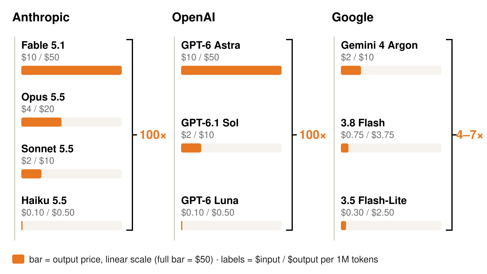

<div class="cols" style="gap:24px;margin-top:6px">
<div class="callout" style="font-size:21px;margin:0">Flagships now think adaptively; you set effort, not on/off.</div>
<div class="callout" style="font-size:21px;margin:0">1M-token context is standard at the frontier.</div>
</div>

<p class="small" style="font-size:16px;margin-top:6px">Prices as of 20 Oct 2026, USD per 1M tokens (input / output); see research/numbers.md. Gemini 4 Argon doubles on 1 Dec 2026.</p>

<!--
Notes:
Engagement first, before revealing the brackets: "Guess before reveal: how much more does the top tier cost than the bottom?" Most people guess 5-10x.
Answer: 100x per token for Anthropic (Fable vs Haiku) and OpenAI (Astra vs Luna); about 4x (output) to 7x (input) for Google, whose flagship is already cheap.
The middle rung is 20x the bottom (Sonnet, Sol), so the cheap tier is 20-100x cheaper per token than what you would otherwise reach for.
Caveat: per-task cost gaps are smaller than per-token gaps because bigger models use different amounts of thinking; on Artificial Analysis Haiku 5.5 is ~28x cheaper per task than Opus 5.5, not 40x.
Thinking: Fable and Opus thinking is adaptive and cannot be disabled; GPT-6 uses effort levels; Argon has thinking levels. All three flagships list ~1M-token context.
Sources: https://platform.claude.com/docs/en/about-claude/pricing ; https://platform.claude.com/docs/en/models/overview ; https://developers.openai.com/api/docs/pricing ; https://developers.openai.com/api/docs/models ; https://ai.google.dev/gemini-api/docs/pricing ; https://artificialanalysis.ai/models/claude-opus-5-5
About 2 minutes.
-->

---

<!-- 05-open-weight -->
<!-- _header: "1 · The model landscape" -->

# Open weights trail the frontier by about a dozen points

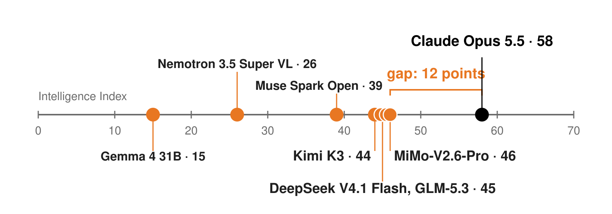

<div class="cols-3">
<div class="callout"><b>Control:</b> choose where inference runs</div>
<div class="callout"><b>Cost:</b> replace API fees with compute and operations</div>
<div class="callout"><b>The trade-off:</b> infrastructure and oversight</div>
</div>

<p style="font-size:21px;margin:0.15em 0"><b>Self-hosting keeps data on hardware you control,</b> but does not by itself meet data-use requirements. An agent with tool or internet access can still send your data out.</p>

<p class="small" style="font-size:17px;margin:0">Artificial Analysis Intelligence Index, 20 Oct 2026; changes monthly, check the live board.</p>

<!--
Notes:
Engagement: guess before reveal. "How far behind are open-weight models?" Take two or three guesses, then show the 12 points.
Top proprietary is Claude Opus 5.5 at 58; top open-weight is Xiaomi MiMo-V2.6-Pro at 46. DeepSeek V4.1 Flash and GLM-5.3 are at 45, Kimi K3 at 44 (Step 5 Preview also 44).
Name the families: DeepSeek, Qwen, Kimi, GLM (Zhipu AI / Z.ai), Mistral, Muse (Meta), Nemotron (NVIDIA), Gemma (Google).
Further left: Meta Muse Spark Open 39 (released 15 Oct 2026), NVIDIA Nemotron 3.5 Super VL 26 (released 15 Oct 2026), Google Gemma 4 31B 15 (Apr 2026, Apache 2.0, runs on a single GPU). Others: Reflection Beam 1.0 30, Thinking Machines Inkling 25, Nemotron 3 Ultra 23, OpenAI gpt-oss-120b 12.
The two dots at 45 are drawn side by side; the leaderboard is dynamic, so re-check on the day.
Open weights let you choose a deployment, including inference on your own cluster. That can give you more control over data access and where processing happens. Open-weight models can also run on hosted services; available weights do not mean that inference is local.
Self-hosting replaces API token charges with compute and operations costs. Model licenses and hardware requirements still apply. Bridge: "What does running one yourself actually take?" (next slide).
Leakage: the weights themselves do not connect to anything; the risk is the software around them. If the agent can browse, call tools or reach external APIs, it can send data out, including when a fetched web page carries injected instructions. Restrict network access when the data matters, and treat model repos that ship custom code (trust_remote_code) as code you are running.
Control is not the same as security: a poorly secured self-hosted server can be worse than a University-licensed service with contractual protections.
Data approval is separate from model availability: follow institutional, IRB, contractual and other applicable guidelines for the specific dataset and deployment. Local hosting does not automatically satisfy them. At Princeton, check OIT's current data classification and approved-tool guidance; do not assume Restricted information is permitted in a local model.
Source: https://artificialanalysis.ai/models/open-source and https://artificialanalysis.ai/leaderboards/models
Data guidance: https://oit.princeton.edu/services/ai-guidance-tools ; https://oit.princeton.edu/about/policies/generative-ai-tools-use-policy
Timing: 2 minutes.
-->

---

<!-- 05b-self-hosting -->
<!-- _header: "1 · The model landscape" -->

# Open weights ≠ self-hosting

<div class="cols" style="gap:24px">
<div class="callout" style="margin:0"><b>Hosted:</b> the lab's API, OpenRouter or a cloud provider. Prompts go to their servers, as with any API.</div>
<div class="callout" style="margin:0"><b>Self-hosted:</b> weights run on hardware you control, such as a campus cluster or rented GPUs.</div>
</div>

<p style="font-size:24px;margin:0.7em 0 0.3em"><b>What self-hosting takes</b></p>

<dl class="kv" style="font-size:23px;margin:0;gap:12px 22px">
<dt>Frontier-class open<br><span class="muted" style="font-weight:400;font-size:19px">DeepSeek, Kimi, GLM, MiMo</span></dt><dd>With light compression, about 3–4 Della GPU nodes or 1–2 GB300 nodes; Kimi K3 about 11 Della or 4 GB300. Someone has to run it.</dd>
<dt>Mid-size open<br><span class="muted" style="font-weight:400;font-size:19px">Gemma 4 31B, Qwen3.8 27B</span></dt><dd>With no compression, one A100 (a quarter node); a ~120B model such as Nemotron 3.5 Super takes a full node.</dd>
</dl>

<p style="font-size:21px;margin:0.6em 0 0">Agents need long contexts and many calls: size for throughput, not a chat demo. Data guidelines apply either way.</p>

<p class="small" style="font-size:16px;margin-top:4px">Della GPU node = 4 × A100 80GB; GB300 node (NVL72 compute tray) = 4 × 288GB. Weights plus ~25% headroom for context; rough estimates.</p>

<!--
Notes:
Point: "open weights" describes the licence and availability of the model file, not where it runs. Many people who say they use DeepSeek or Kimi are calling a hosted API (the lab's own, OpenRouter, a cloud provider); their prompts leave the building exactly as with Claude or GPT, under that provider's terms.
Frontier-class open models are mixture-of-experts with hundreds of billions to trillions of total parameters. Only a fraction is active per token, but all the weights must sit in GPU memory.
Rule of thumb: memory ≈ parameters × bytes per parameter (2 at BF16, 1 at 8-bit, 0.5 at 4-bit) plus ~25% for context cache and runtime. One Della GPU node (4 × A100 80GB) holds 320 GB.
At 8-bit: GLM-5.3 (~753B) and DeepSeek V4.1 Flash (552-763B, disputed) about 3 nodes; Muse Spark Open (816B) and MiMo-V2.6-Pro (~1.02T) about 4; Kimi K3 (~2.8T) about 11. Double these at BF16; roughly halve them at 4-bit, with some quality loss. Della has 70 such nodes, so one frontier model is a noticeable share of the shared cluster.
"Light compression" on the slide means 8-bit weights: half the full-precision size, usually with little quality loss.
GB300 comparison: one GB300 NVL72 compute tray has 4 Blackwell Ultra GPUs × 288 GB = 1,152 GB, 3.6x a Della node. At 8-bit: DeepSeek V4.1 Flash, GLM-5.3 and Muse Spark Open fit in 1 tray, MiMo-V2.6-Pro needs 2, Kimi K3 about 4. Blackwell runs FP8 and FP4 natively, so at 4-bit Kimi K3 fits in 2 trays. Trays in an NVL72 rack share one NVLink domain across 72 GPUs, so spanning trays is far easier than spanning Della nodes over InfiniBand.
Caveats: A100s have no native FP8, so 8-bit serving relies on weight-only kernels and is slower than on H100/H200 (Della's PLI and AI Lab nodes). Spanning nodes over InfiniBand works but adds latency and setup. Long agent contexts can need far more than 25% headroom. Parameter counts are mostly vendor-reported via aggregators.
Mid-size: Qwen3.8 27B (~54 GB at BF16) and Gemma 4 31B (30.7B, ~61 GB) fit on one A100 80GB, tightly for Gemma; NVIDIA Nemotron 3.5 Super (120B total / 12B active, ~240 GB at BF16) takes a full node, or two GPUs at 8-bit. A quantized ~30B model also runs on a high-end workstation. These models sit well below the frontier on the previous slide's chart.
Add serving software (vLLM, SGLang), monitoring and updates: someone has to own it.
Agentic workloads are heavier than chat: long contexts grow the memory needed per request, and an agent makes many calls per task, so throughput matters.
Cost: GPUs cost money whether or not they are busy; self-hosting tends to pay off only at high, steady utilisation. Check what your campus research computing already provides before buying anything.
Data: self-hosting can give more control over where processing happens, but it does not by itself satisfy institutional, IRB or contractual requirements. See Princeton OIT guidance.
Numbers: research/numbers.md sections 2 and 8.
Timing: 1.5 minutes.
-->

---

<!-- 06-picking-a-model -->
<!-- _header: "1 · The model landscape" -->

# Pick the tier by the job

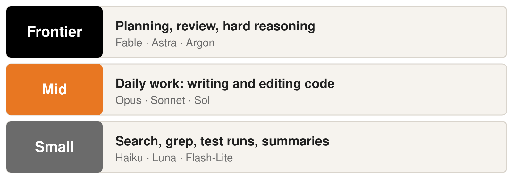

<div class="cards two"><div class="tip">use multiple models for same problem</div><div class="tip">Adversarial development/brainstorming using Claude vs. Codex</div></div>

<!--
Notes:
Rule of thumb: frontier plans and reviews, mid does the daily editing, small does the fetching.
Names: Fable/Astra/Argon (frontier), Opus/Sonnet/Sol (mid), Haiku/Luna/Flash-Lite (small). Names change every few months; the tiers do not.
In practice most people code with Claude Code or Codex, so the real choice is the tier or effort level inside the tool, not which leaderboard model to adopt. Both tools let you switch the model and effort level.
If someone asks how to compare models: use benchmarks that match the task (https://artificialanalysis.ai/leaderboards/models) and a few examples from your own research; usage rankings such as https://openrouter.ai/rankings show popularity, not correctness.
Read the two tips; ask: "Who has had one model review another's code?"
Prices per tier: see research/numbers.md section 1.
Timing: 2 minutes.
-->

---

<!-- 07-quiz -->
<!-- _header: "2 · Tokens, cost and delegation" -->

# Three tasks. Which tier would you use?

<div class="quiz">
<div class="task">Find every call to a deprecated function in a 40,000-line codebase.</div>
<div class="task">Design the analysis for a new dataset nobody in the group has worked with.</div>
<div class="task">Summarize 20 log files from last night's runs into one paragraph each.</div>
</div>

<p class="small">Options: Frontier · Mid · Small</p>

<!--
Notes:
Collect answers from the room before advancing. 2 minutes.
-->

---

<!-- 08-quiz-reveal -->
<!-- _header: "2 · Tokens, cost and delegation" -->

# The ladder, applied

<div class="quiz">
<div class="task">Find every call to a deprecated function in a 40,000-line codebase.<span class="badge small">Small</span><span class="why">grep-shaped: many files, no judgement, a cheap model in a subagent</span></div>
<div class="task">Design the analysis for a new dataset nobody in the group has worked with.<span class="badge frontier">Frontier</span><span class="why">one hard reasoning task where a wrong plan costs weeks</span></div>
<div class="task">Summarize 20 log files from last night's runs into one paragraph each.<span class="badge small">Small</span><span class="why">20 parallel summaries; the parent only reads the conclusions</span></div>
</div>

<p class="small">Frontier: plans, reviews, hard reasoning · Mid: daily work · Small: search, test runs, summaries</p>

<!--
Notes:
The point is that most volume is small-tier work. The frontier model is for the few decisions that matter.
-->

---

<!-- 09-what-burns-tokens -->
<!-- _header: "2 · Tokens, cost and delegation" -->

# Tools compact for you; you clear between tasks

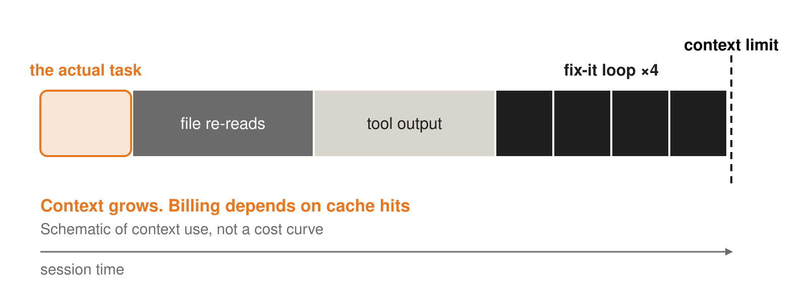

Auto-compaction keeps long sessions running. When you switch to unrelated work, start fresh with `/clear`: it costs nothing, and the next task starts without stale assumptions.

<div class="callout" style="font-size:21px">Every request, including each tool call, re-sends the conversation so far. Repeated text is billed at a discount, not for free, so an all-day session keeps getting more expensive.</div>

<!--
Notes:
What changed: current harnesses manage the context window themselves. Claude Code auto-compacts (summarizes older history) as it nears the limit and clears old tool results; OpenAI's API and Codex have their own automatic compaction. Frontier models list ~1M-token windows (slide 4). You rarely need to compact by hand.
What you still do: clear between unrelated tasks. Claude Code's cost docs list this first; /clear costs nothing, while /compact reads the whole conversation it summarizes, so compacting a large context is itself a large request. Use /rename before /clear if you may want to /resume later.
Caveat, from experience: compaction is a lossy summary, and it can carry an old instruction forward without its context. In one session the summary kept an earlier force-push command, and after compaction the agent ran a force push that was not intended. Lessons: after an auto-compact, check what the agent thinks it is doing before letting it continue; put rules like "never force push" in CLAUDE.md or compact instructions so they survive; and block destructive commands (force push, rm -rf, dropping tables) with permission deny rules rather than trusting the summary.
Cost: every request sends the conversation so far, and one turn can be many requests because each batch of tool results goes back in a new request. After compaction or tool-result clearing, "so far" means the compacted version. With the OpenAI Responses API the server can hold the history (previous_response_id), but the prior tokens are still billed as input. With prompt caching that history is billed at the cheaper cached rate, but a one-line question in an all-day session still pays for the whole history, and the first message after the cache expires reprocesses it at full price.
Quality: long, cluttered contexts still degrade answers, especially in agentic work, though less than with older models; published long-context benchmarks mostly cover previous-generation models, so treat this as a caveat, not a law.
Colleague's original tip: "Restarting sessions, it often gets confused with too much context". Present it as lived experience.
If you do restart mid-task, save a verified handoff first: goal, decisions, commands and remaining work.
Sources: https://code.claude.com/docs/en/costs ; https://code.claude.com/docs/en/prompt-caching ; https://developers.openai.com/api/docs/guides/compaction
Ask the room: who has had a session get worse the longer it went?
About 1.5 minutes. Schematic, not measured data.
-->

---

<!-- 10-delegation -->
<!-- _header: "2 · Tokens, cost and delegation" -->

# Big model decides; small models fetch

<div class="cols" style="grid-template-columns:470px 1fr;gap:32px">
<div>

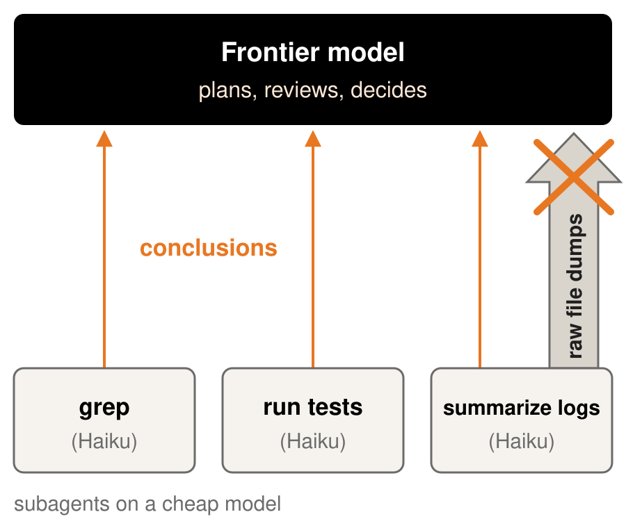

</div>
<div>
<pre style="font-size:16px;margin-top:0"><code>---
name: test-runner
description: Runs the test suite, reports only failures
model: haiku
tools: Bash, Read, Grep
---
Run `pytest -q`. Do not fix anything.
Report passed/failed counts and, per failure:
test name, assertion message, likely file:line.
No file contents, no full tracebacks.</code></pre>
<div class="small" style="font-size:18px;font-weight:700;color:#1f1f1f;margin-top:8px">What the parent sees back:</div>
<pre style="font-size:16px;white-space:pre-wrap;margin-top:4px"><code style="white-space:pre-wrap;word-break:break-word">47 passed, 2 failed.
test_inversion.py::test_misfit_zero: expected 0.0, got 1.3e-4 (tolerance; misfit.py:88)
test_io.py::test_read_sac: FileNotFoundError data/sample.sac (fixture missing)</code></pre>
<div class="small" style="font-size:17px">This file lives in <code>.claude/agents/</code>; more in section 4.</div>
</div>
</div>

<!--
Notes:
Subagents run in their own context window on a cheaper model, do the noisy work (search, grep, test runs, log summaries) and hand back a short conclusion.
The parent's context stays small and on-task; the expensive model only reads three lines instead of a 2,000-line pytest log.
Walk through the definition: model: haiku picks the cheap tier, tools limits what it may touch, and the prompt says what to return and what not to.
Point at the result: you, and the parent, can act on it immediately; the tolerance failure is a judgement call for the frontier model or for you.
Other harnesses name this differently (check your tool's docs); the principle carries over: return conclusions, not dumps.
Haiku is 20-40x cheaper per token than Sonnet/Opus (see slide 4; https://platform.claude.com/docs/en/about-claude/pricing).
About 2 minutes.
-->

---

<!-- 11-other-levers -->
<!-- _header: "2 · Tokens, cost and delegation" -->

# Recap: habits that cut cost

<style scoped>.callout{margin:0.25em 0;padding:8px 16px} td,th{padding:5px 12px}</style>
<div class="cols" style="gap:14px;font-size:21px">
<div class="callout"><b>Clear between tasks.</b> Auto-compact handles long sessions; <code>/clear</code> starts fresh for new work.</div>
<div class="callout"><b>Scope AGENTS.md</b> to what every session needs; everything else goes in a file the agent reads on demand.</div>
<div class="callout"><b>Background long jobs</b> and check in; do not sit in a chat window watching tests.</div>
<div class="callout"><b>Use the ladder:</b> frontier to plan, mid to build, small to fetch.</div>
</div>

**Rough cost per tier, 20 Oct 2026**

<div style="font-size:18px">

| Tier | $ per 1M output tokens | AA cost per Index task |
|---|---|---|
| Fable 5.1 | $50 | $7.63 |
| Opus 5.5 | $20 | $5.98 |
| Sonnet 5.5 | $10 | $5.46 |
| Haiku 5.5 | $0.50 | $0.21 |

</div>

<p class="small" style="font-size:17px;margin:0">Cost per task is Artificial Analysis benchmark tasks, not coding sessions. Haiku output price is for prompts up to 100k tokens.</p>

<!--
Notes:
Section recap: clearing and the ladder repeat earlier slides; scoping AGENTS.md and backgrounding long jobs are new. None needs setup. Spend one line on each.
Table point: list prices differ 100x between Fable and Haiku, but per benchmark task the top three are close, because the cheaper models think longer. Haiku really is about 26x cheaper than Sonnet (28x vs Opus).
Caveat out loud: benchmark tasks are not agentic coding sessions; no official per-session cost page exists.
Engagement: "Who clears between tasks, and who keeps one session open all day?"
Sources: https://platform.claude.com/docs/en/about-claude/pricing ; https://artificialanalysis.ai/models/claude-opus-5-5 (and sonnet-5-5, haiku-5-5, fable-5-1)
Timing: 2 minutes.
-->

---

<!-- 12-supervisor -->
<!-- _header: "3 · Reviewing agent output" -->

# You are the supervisor, not the user

The relationship is closer to PI-and-student than tool-and-user: you delegate, you review, you sign off. One difference: a student shares responsibility for their work. An agent can't, so all of it is yours.

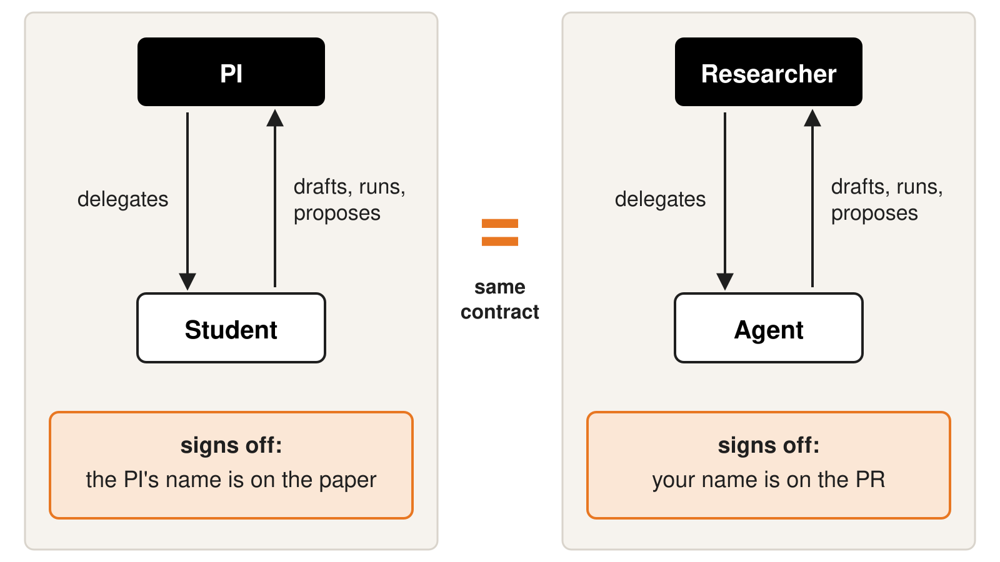

<!--
Notes:
This is the thesis slide. Pause on it.
Left side is the lab you already know: the PI hands off a question, the student drafts and runs, the PI signs the paper.
Right side is the same contract: you delegate, the agent drafts, runs and proposes, your name goes on the PR or paper.
Ask: "If the student's analysis is wrong, whose name is on the retraction?" Answer: both of yours. With an agent, only yours.
The kernel policy says it flatly: agents may not sign off; only humans certify (docs.kernel.org/process/coding-assistants.html).
Timing: 2 minutes.
-->

---

<!-- 13-failure-modes -->
<!-- _header: "3 · Reviewing agent output" -->

# It fails in specific ways, so review for them

<div style="font-size:21px">

| Failure mode | What it looks like |
|---|---|
| Plausible-but-wrong code | Runs, returns a number; the number is wrong |
| Silent assumptions | Picks units, date range or NaN handling you never stated |
| Misused APIs | Real function, wrong arguments or semantics; now and then one that doesn't exist |
| Tests that pass for the wrong reason | Never ran, skipped, or edited until green |
| Confident claims | An interpretation stated as fact, never checked against data |
| Over-engineering | Abstractions pile up over many changes |

</div>

<div class="cards one" style="font-size:19px"><div class="tip" style="font-size:19px">Ask AI to list the problems in the code it generated</div></div>

<p class="small" style="margin:0">A supervisor who knows the typical failure modes reviews better. Slide 30 says what to do about each.</p>

<!--
Notes:
Six patterns, one sentence each; do not read the table aloud.
Engagement: "Which of these have you already been bitten by?" Take two answers.
Most of these only show up if you open the code or the data; a crash is the easy case.
The first row is what the next slide's exercise is.
Read the tip; it is cheap and works.
Point forward: slide 30 gives the countermeasure for each failure mode.
Timing: 3 minutes.
-->

---

<!-- 14-spot-the-bug -->
<!-- _header: "3 · Reviewing agent output" -->
<!-- _class: code-lg -->
<style scoped>pre{font-size:20px;line-height:1.2}</style>

# Spot the bug <span class="timer">60 s</span>

Goal: report the mean trial speed in m/s, using only trials marked "ok".

```python
trials = [
    # start_ms, end_ms, distance_cm, quality
    (1000,  4000, 1200, "ok"),
    (5000, 10000, 3000, "ok"),
    (11000, 14000, 9000, "bad"),
]

speeds = []
for start, end, distance, quality in trials:
    if quality != "ok":
        continue
    elapsed = end - start
    distance_m = distance / 100
    speed = distance_m / elapsed
    speeds.append(speed)

mean_speed = sum(speeds) / len(speeds)
print(f"Mean trial speed: {mean_speed:.3f} m/s")
```

<!--
Notes:
Start the 60-second timer. Say: "An agent wrote this to summarize instrument trials. It filters bad trials and prints a mean. It runs without errors. Is the result right?"
The goal is the arithmetic mean of the individual speeds for trials marked ok, with each accepted trial weighted equally. It is not the overall distance divided by overall time. Each supplied trial has positive duration, and there are accepted trials, so division by zero is not an issue in this example.
Input units are specified in the tuple header: times in milliseconds and distances in centimetres. The code correctly filters quality and converts distance to metres, but never converts elapsed time to seconds. This is the only intended analysis error.
Let people read; at 60 s take two or three answers from the room, then advance.
The point: follow units through the whole calculation. Correct filtering and one correct conversion can make an incomplete conversion easy to overlook.
Timing: about 2 minutes including answers.
-->

---

<!-- 15-bug-reveal -->
<!-- _header: "3 · Reviewing agent output" -->
<!-- _class: code-lg -->
<style scoped>pre{font-size:20px;line-height:1.2}</style>

# The bug: time never converted to seconds

<pre><code class="language-python">trials = [
    # start_ms, end_ms, distance_cm, quality
    (1000,  4000, 1200, "ok"),
    (5000, 10000, 3000, "ok"),
    (11000, 14000, 9000, "bad"),
]

speeds = []
for start, end, distance, quality in trials:
    if quality != "ok":
        continue
    <mark class="bug">elapsed = end - start</mark>
    distance_m = distance / 100
    speed = distance_m / elapsed
    speeds.append(speed)

mean_speed = sum(speeds) / len(speeds)
print(f"Mean trial speed: {mean_speed:.3f} m/s")
</code></pre>

**Fix:** <code>elapsed = (end - start) / 1000</code>. Correct mean: **5.000 m/s**.

<!--
Notes:
The highlighted line leaves elapsed time in milliseconds. The next line correctly converts centimetres to metres, so the later division gives metres per millisecond while the output label says metres per second. The reported mean is 1,000 times too small.
Fix: convert elapsed time to seconds on the highlighted line. The accepted trials are 12 m / 3 s = 4 m/s and 30 m / 5 s = 6 m/s. Their arithmetic mean is 5 m/s. The third trial is correctly excluded by its quality flag. The buggy code prints 0.005 m/s; the corrected code prints 5.000 m/s.
How to catch it: work one accepted trial by hand and check the units at each step. For a real instrument pipeline, state input and output units in the task and test against a known measurement.
Ask: "Would you have caught this in a 400-line PR?" In a longer pipeline, the input units may live in a file header or instrument manual, far from the calculation.
Timing: about 1.5 minutes.
-->

---

<!-- 16-oss-policies -->
<!-- _header: "3 · Reviewing agent output" -->

<style scoped>td,th{padding:5px 12px} .stat{padding:12px 10px 10px}</style>

# Open source already expects a supervisor

<div class="stats" style="margin:0.1em 0 0.2em">
<div class="stat" style="padding:12px 12px 10px"><div class="n" style="font-size:72px">78%</div><div class="c">of project AI policies allow AI-assisted contributions</div></div>
<div class="stat" style="padding:12px 12px 10px"><div class="n" style="font-size:72px">51%</div><div class="c">require disclosure</div></div>
<div class="stat" style="padding:12px 12px 10px"><div class="n" style="font-size:72px">74%</div><div class="c">require a human in the loop</div></div>
</div>
<div class="small" style="font-size:16px">118 AI policies across 1,000 popular GitHub repositories. Hora &amp; Robbes, ICSME 2026, arXiv 2605.16706.</div>

<div style="font-size:19px">

| Project | Policy | What it says about the supervisor |
|---|---|---|
| Linux kernel | AI-assisted patches allowed; only a human adds Signed-off-by and takes full responsibility; `Assisted-by` tag. | The tool may draft, the human signs. |
| LLVM | "Human in the loop" (Jan 2026): a human reviews all output; label substantial tool-generated content. | Disclosure is a courtesy to the reviewer whose time you are spending. |
| GCC | Steering committee (29 Jul 2026) declines "legally significant" LLM-derived code; small, marked changes OK. | When authorship is uncertain, the project would rather not carry the risk. |

</div>

<div class="small" style="font-size:16px">Fresh: a patch dropping the kernel's Assisted-by tag reached the docs tree on 14 Oct 2026, not yet mainline. Accountability stays.</div>

<!--
Notes:
Before revealing: "Of projects that wrote an AI policy, what share allow AI help? Require disclosure? Require a human in the loop?" Take guesses, then reveal.
Source for the three numbers: Hora & Robbes, ICSME 2026, https://arxiv.org/abs/2605.16706
The pattern in all three projects: tools are fine, a named human is accountable. Kernel: https://docs.kernel.org/process/coding-assistants.html ; LLVM: https://llvm.org/docs/AIToolPolicy.html ; GCC: https://lwn.net/Articles/1086041/
Kernel debate (Maintainers Summit, 8 Oct; Sasha Levin's patch applied to the docs tree 14 Oct, still not in mainline as of 19 Oct): https://phoronix.com/news/Linux-Dropping-Assisted-By-Req ; https://www.fosslinux.com/162933/ai-assisted-kernel-linux-7-3.htm
Room vote: "If accountability is already clear, should disclosure still be required?" Hands up yes / no.
Full landscape: RedMonk tracks the AI policies of 86 organizations.
Timing: about 3 minutes with the guess and the vote.
-->

---

<!-- 17-research-output -->
<!-- _header: "3 · Reviewing agent output" -->

# Research output meets the same standard

<div class="cols" style="grid-template-columns:1fr 450px;gap:28px">
<div style="font-size:21px">
<dl class="kv" style="margin:0;gap:10px 18px">
<dt>Reproducibility</dt><dd>A script you can rerun and review beats an answer you can't.</dd>
<dt>Disclosure</dt><dd>Check the applicable policies. In most cases, be transparent about how you used AI.</dd>
<dt>Data</dt><dd>Follow the guidelines for each dataset and deployment. Local hosting does not automatically meet them.</dd>
<dt>Permissions</dt><dd>Sandbox the agent. No live database credentials.</dd>
</dl>
<div class="cards one"><div class="tip">Have the AI write code to do the task, not directly do the task</div></div>
</div>
<div>

<div style="font-size:23px;padding-top:4px">
<strong>Check each case before use</strong>
<ul style="margin-top:16px">
<li>Data classification and institutional policy</li>
<li>IRB protocol and participant consent</li>
<li>Data-use agreements and export controls</li>
<li>Approval for the tool and deployment</li>
</ul>
<p class="small" style="font-size:19px;margin-top:18px">Check Princeton OIT guidance and the requirements for your project.</p>
</div>

</div>
</div>

<div class="punch" style="margin-top:0.3em">Verification is the hardest job to delegate.</div>

<!--
Notes:
Same four questions as the open-source projects, applied to papers and datasets.
Reproducibility: the script is the artifact you can review, rerun and publish; a chat answer is not.
Disclosure: check the policies of your journal, funder, institution and project. In most cases, be transparent about how you used AI; follow any specific disclosure requirements for the work you submit.
Data: use the checklist for each case. A label such as "unpublished", "PII" or "IRB-covered" does not by itself determine which AI use is permitted. Check the applicable data classification, institutional policy, consent and IRB terms, agreements and export controls, then confirm approval for the specific tool and deployment. Do not assume code or anonymized summaries are automatically cleared for sharing.
Open weights can give you control over where inference runs, but local hosting alone does not establish compliance. Princeton's current OIT guidance permits Internal and Confidential information only in University-licensed tools and says Restricted University Information must not be used with any AI tool. Follow project-specific requirements as well; ask the responsible office when approval is unclear.
Sources: https://oit.princeton.edu/services/ai-guidance-tools ; https://oit.princeton.edu/about/policies/generative-ai-tools-use-policy
Second tip (read aloud): "git worktrees and a remote environment without DB access have long-running sessions operating in the background"
Prompt: "For one of your datasets, which guidelines apply, and which tool and deployment are approved?"
Land the last line slowly: it is the handoff to the second presenter.
-->

---

<!-- 18-handoff -->
<!-- _class: handoff -->
<!-- _header: "" -->

# "Verification is the hardest job to delegate."

<div class="who">Handoff</div>

<!--
Notes:
The first half ends on what the supervisor owes; the second half opens with how supervising is done.
Swap the room-watching role here.
-->

---

<!-- 19-claude-md -->
<!-- _header: "4 · Setting up the workspace" -->

<style scoped>pre{font-size:15px;line-height:1.3} .cols>div:last-child{font-size:22px} .tip{font-size:19px;padding:8px 16px 10px}</style>

# AGENTS.md: standing instructions for every session

<div class="cols">
<div>

```markdown
# SPECFEM++
C++20 spectral-element seismic wave solver,
portable to CPU and GPU via Kokkos.

## Layout
- `core/specfem/` -- all C++ library code
- `tests/unit-tests/` -- GoogleTest suite
- `docs/` -- Sphinx + Doxygen (RST)

## Critical conventions
- `snake_case` for functions and files
- No `using namespace`; no anonymous namespaces
- `#pragma once`, never `#ifndef`

## Build
cmake --preset <name> && cmake --build build/<name>
ctest --test-dir build/<name>
```

</div>
<div>

**What it is:** two lines on the repo, so the agent starts oriented.

**How to build and test:** the exact commands, so it can check its own work.

**Conventions:** the rules a newcomer would break first.

**What not to touch:** generated files, vendored code, legacy readers.

**One file, every tool:** Codex, Cursor, Antigravity read it; Claude Code only if there is no CLAUDE.md.

</div>
</div>

<div class="cards one"><div class="tip">Clear Agents.md / Claude.md files</div></div>

<span class="small">The build you just watched had no AGENTS.md; with one, the agent would have known the test command before its first edit.</span>

<!--
Notes:
This is a condensed copy of the real SPECFEM++ instruction file (a CLAUDE.md in that repo), about 14 lines.
Point at the build block: that is what lets the agent verify its own work.
"What not to touch" is not in the SPECFEM++ file shown; say it is worth adding.
Lead with AGENTS.md: it is the cross-tool convention, so one file works whichever agent a student picks.
Claude Code support is recent (v2.1.277, Sep 2026) and is a fallback: any CLAUDE.md or CLAUDE.local.md in the directory or above wins and AGENTS.md is ignored. Have both? Put `@AGENTS.md` in CLAUDE.md, or change the Project instructions setting in /config.
Callback: the build an hour ago had no AGENTS.md.
Timing: 2 minutes.
-->

---

<!-- 20-dot-claude-tour -->
<!-- _header: "4 · Setting up the workspace" -->

# Example: Claude Code's .claude/ folder

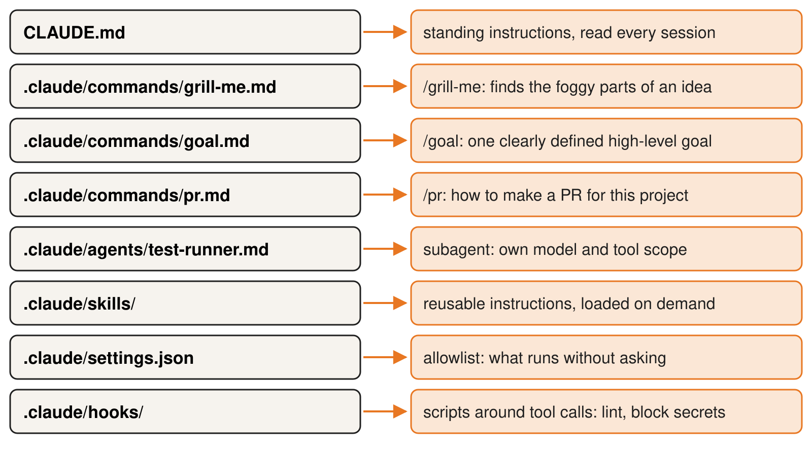

<p class="small muted center" style="font-size:17px;margin:2px 0 6px">Claude Code is the example; other agents have their own folders for the same jobs. Codex: <code>AGENTS.md</code>, skills in <code>.agents/skills/</code>, settings in <code>~/.codex/config.toml</code>.</p>

<div class="cards one"><div class="tip">Write a pr.md that explains how to make PR for your project</div></div>

<!--
Notes:
Walk the tree top to bottom, one phrase per item.
Say up front: this is Claude Code's layout, used as the example. The ideas (standing instructions, reusable prompts, subagents, allowlist, hooks) exist in most agents under different names and folders.
Codex: AGENTS.md for instructions, .agents/skills/ for skills (scanned from the working directory up to the repo root), ~/.codex/config.toml for approvals and sandbox. Source: https://learn.chatgpt.com/docs/build-skills (accessed 2026-10-21).
The starter kit keeps the portable part in AGENTS.md and prompts/; .claude/ is only an adapter.
Commands are prompts you type as slash commands; settings.json is the allowlist.
Hooks are the guardrails: lint on save, block secrets.
A 60-second screen share of a real folder may replace this slide.
Timing: 2 minutes.
Prompt to try later: /grill-me on your own half-formed idea.
-->

---

<!-- 21-markdown-memory -->
<!-- _header: "4 · Setting up the workspace" -->

# Markdown is the agent's external memory

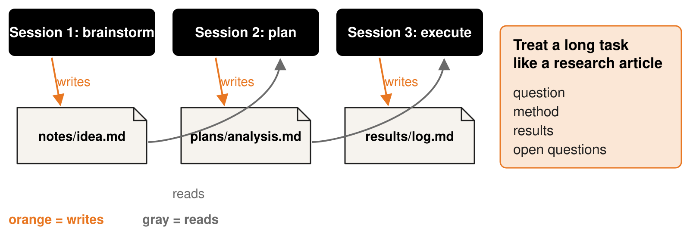

<div class="cards two">
<div class="tip">write brainstorming and planning notes to markdown so you have a record and can use that for context in a future session</div>
<div class="tip">Using skills, treating a long task as a "research article" so it is easy to track and verify, using git as a way of tracking progress for bigger projects</div>
</div>

You get a record; the next session gets context.

<!--
Notes:
Each session starts empty; files are how it remembers.
Orange arrows write, gray arrows read.
Research-article framing: question, method, results, open questions.
Suggest committing the notes with git so progress is tracked.
Timing: 2 minutes.
-->

---

<!-- 22-git-safety-net -->
<!-- _header: "4 · Setting up the workspace" -->

# Git helps you review and recover code

<ul style="font-size:22px; margin:0 0 6px 0;">
<li><strong>Commit checkpoints:</strong> compare tracked changes and revert unwanted commits.</li>
<li><strong>Worktrees:</strong> separate working directories and branches for parallel sessions.</li>
<li><strong>Long runs:</strong> use a sandbox and limit filesystem, network and credential access.</li>
</ul>

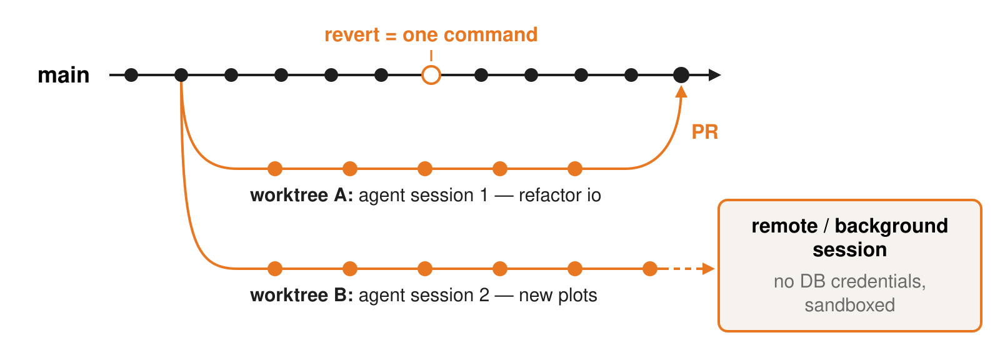

<p class="small" style="margin:0">Git does not recover untracked data or undo external actions. Worktrees are not security boundaries.</p>

<div class="cards one"><div class="tip">git worktrees and a remote environment without DB access have long-running sessions operating in the background</div></div>

<!--
Notes:
~2 min. Git gives you recorded checkpoints and diffs for reviewing code changes. It does not make every agent action reversible.
Commit a known-good baseline before a substantial agent task, then review and commit small, coherent changes. For a recorded commit, git revert creates a new commit that reverses its changes; it can require conflict resolution. Bare git checkout is not an undo command.
Worktrees: two agent sessions use separate working directories and branches in one shared repository. This reduces interference between file edits, but shared repository state and external resources still need coordination. A comes back through a PR for human review.
B runs remotely in the background. Remote hosting alone does not provide isolation: configure a sandbox, restrict filesystem and network access, and supply only the credentials the task needs. No database credentials in this example.
Git cannot reverse a database write, an external submission, leaked credentials or compute spending, and it does not preserve untracked files. Protect data separately and limit consequential actions before starting a long run.
Read the colleague's tip as an example of their workflow, not a guarantee that worktrees contain all possible damage.
Ask: who already commits before letting an agent loose? Who has lost work to one?
-->

---

<!-- 23-mcp -->
<!-- _header: "4 · Setting up the workspace" -->

# MCP: connect the agent to what you already use

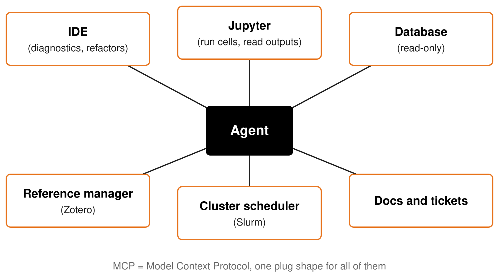

<div class="cards one"><div class="tip">Have MCP server running to utilize IDE features</div></div>

<span class="small">Examples only; no setup walkthrough today. Each server is a few lines in settings.</span>

<!--
Notes:
Keep this to 60 seconds.
One plug shape: any tool that speaks MCP can be offered to the agent.
Examples are illustrative; pick the one your audience uses.
Read-only first for databases and schedulers.
No live setup today.
-->

---

<!-- 24-the-loop -->
<!-- _header: "5 · Working patterns from your colleagues" -->

# Supervising is a loop: plan, small steps, review

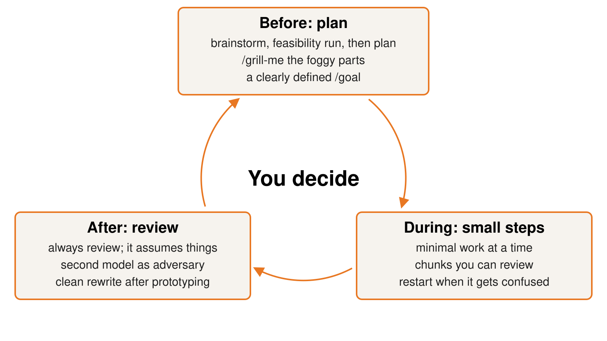

<p class="small center" style="margin:0;">The next three slides are one lap around this loop. The tips are your colleagues', quoted as written.</p>

<!--
Notes:
~1.5 min. Section opener; let the figure carry it, do not read every phrase.
Before: plan. During: small steps. After: review. Then back to planning. The agent drafts and runs; you decide at every turn.
Credit the room: these tips came from 23 colleagues on campus.
Ask: are any of the authors here? Would you say one sentence about the story behind your card?
Then: the next three slides take one lap, one stage each.
-->

---

<!-- 25-before-plan -->
<!-- _header: "5 · Working patterns from your colleagues" -->

# Before: plan, and let it interrogate the plan

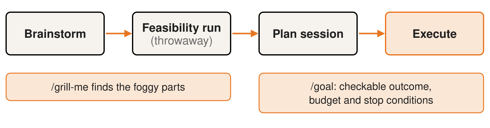

<div class="cards">
<div class="tip">Brainstorm + feasibility run before running the plan session</div>
<div class="tip">/grill-me to figure out the foggy areas of an idea</div>
<div class="tip">Providing it a clearly defined, high-level /goal and checking in on the agent after the agent completed</div>
</div>

**Planning is cheaper than fixing:** a bad plan costs a page of markdown, a bad build costs a day of review.

<!--
Notes:
Lap one of the loop: plan, small steps, review. About 1.5 minutes here.
Walk the strip left to right; the feasibility run is thrown away on purpose, it only tells you if the idea is possible.
Live prompt to show: "/grill-me" on a half-formed idea, then answer its questions.
/goal needs one outcome you could verify; check in when it reports done, not before.
Land the last line: the researcher owns the plan, so spend the effort here.
-->

---

<!-- 26-during-small-steps -->
<!-- _header: "5 · Working patterns from your colleagues" -->

# During: small steps you can actually review

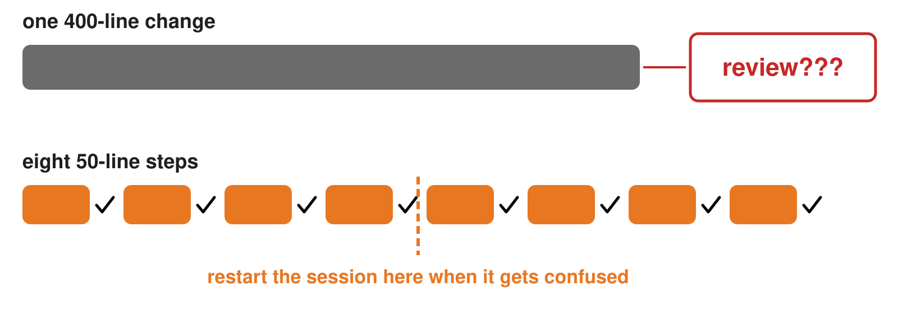

<div class="cards">
<div class="tip">work in small chunks so you can understand and review</div>
<div class="tip">Having it do minimal work at a time</div>
<div class="tip">Don't get stuck with too much AI written code that then needs to be reviewed</div>
</div>

<!--
Notes:
Lap two. About 2 minutes.
Top lane: 400 lines arrive at once and review becomes rubber-stamping. Bottom lane: each 50-line step gets checked before the next.
Moved to notes (it is on the figure): "Restarting sessions, it often gets confused with too much context".
Prompt: "Do only step 1 of the plan, then stop and show me the diff."
-->

---

<!-- 27-after-review -->
<!-- _header: "5 · Working patterns from your colleagues" -->

# After: review as if a student handed it in

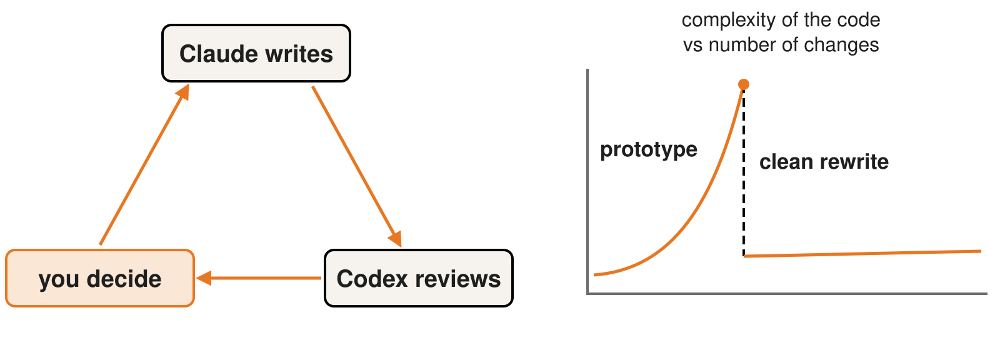

<ul class="check">
<li>Read every line you would sign for</li>
<li>Ask it to list the problems in its own code</li>
<li>Refactor under regression tests. Rewrite when the design warrants it</li>
</ul>

<div class="cards one">
<div class="tip">Always review the code. It often makes mistakes or assumes things different than your implicit assumptions</div>
</div>

<!--
Notes:
Lap three, then close the loop back to the plan. About 2 minutes.
You are the supervisor: the second model reviews, you decide.
The second-model review is on the figure; moved to notes: "Adversarial development/brainstorming using Claude vs. Codex"; "Ask AI to list the problems in the code it generated"; "use for reviewing changes and updating docs/tests for consistency".
Prompt: "List every assumption and weak spot in the code you just wrote."
Right chart is illustrative, not measured data or a guarantee that complexity always rises. Once the prototype works, add regression tests around known behavior and refactor in small steps. Consider a rewrite when the design blocks progress, with checks that preserve the intended scientific results.
Colleague's original preference: "it often creates an over engineered mess after a while of changes. Once the prototyping is done it is good to do a clean rewrite". A rewrite can be appropriate, but is not the default response to a working prototype.
-->

---

<!-- 28-mindset -->
<!-- _header: "5 · Working patterns from your colleagues" -->
<style scoped>.tip{font-size:25px;padding:16px 20px 18px} .cols-3 strong{font-size:30px}</style>

# Mindset: ambitious on the problem, strict on the output

<div class="cols-3">
<div>

**Be ambitious.**

<div class="cards one"><div class="tip">be extremely ambitious, especially regarding attempting new research or mathematical approaches</div></div>

</div>
<div>

**Build to understand.**

<div class="cards one"><div class="tip">Generating Claude ai artifacts to understand complicated ideas</div></div>

</div>
<div>

**Write your own prose.**

<div class="cards one"><div class="tip">Don't use it to write prose. If you can't be bothered to write it then no-one should be bothered to read it</div></div>

</div>
</div>

<div class="punch" style="margin-top:1.2em">The tool lowers the cost of trying. It does not lower the bar for what you hand in.</div>

<!--
Notes:
Three tips from the room, each a stance rather than a technique.
Ambitious: try the approach you would not have had time for; the cost of a failed attempt is now an afternoon.
Artifacts: a small interactive page or plot beats re-reading a derivation.
Prose: if you cannot be bothered to write it, nobody should be bothered to read it. Ask the room whether they agree; some will not.
Timing: 1 minute.
-->

---

<!-- 29-failure-counter-moves -->
<!-- _header: "5 · Working patterns from your colleagues" -->

# Each failure mode has a counter-move

<style scoped>td,th{padding:5px 12px} p.small,.callout{margin:0.3em 0}</style>
<div style="font-size:21px">

| Failure mode | Counter-move |
|---|---|
| Plausible-but-wrong code | test it on a case with a known answer; follow units through |
| Silent assumptions | ask it to list its assumptions before it runs; state units, ranges, NaN policy in the prompt |
| Misused APIs | run it; pin versions; let a subagent check the docs |
| Tests that pass for the wrong reason | make it show the command and the output; check the diff for skipped or edited tests; run the suite yourself before the PR |
| Confident claims | ask for the check it would run, then run it |
| Over-engineering | refactor under regression tests. Consider a rewrite when the design warrants it |

</div>

<p class="small">Pairs with slide 14; same failures, now the response.</p>

<div class="callout">Use known results to check that structural changes preserve the intended behavior.</div>

<!--
Notes:
Go row by row. The counter-move is the action you take, not a way to avoid the failure.
Regression tests should capture trusted behavior or known scientific results, not merely reproduce the current implementation. Refactor in small steps; choose a rewrite when the design warrants the additional effort and regression risk.
-->

---

<!-- 30-checklist -->
<!-- _header: "6 · Starter kit and discussion" -->

# One page to take home

<div class="cols-3">
<div><strong>Setup</strong>
<ul class="check">
<li>AGENTS.md with layout, test command, conventions</li>
<li>Git: commit often, worktrees for parallel sessions</li>
<li>Permissions: sandbox, no live credentials</li>
</ul></div>
<div><strong>Loop</strong>
<ul class="check">
<li>Plan first, /grill-me the foggy parts</li>
<li>Small steps you can review</li>
<li>Review as a supervisor, second model as adversary</li>
</ul></div>
<div><strong>Responsibility</strong>
<ul class="check">
<li>Disclose per the project's or journal's policy</li>
<li>Mind the data: nothing restricted into a hosted model</li>
<li>Never let an agent open a PR you have not read</li>
</ul></div>
</div>

<div class="callout">Clone the starter kit: <code>starter-kit/</code> in this talk's repo (an AGENTS.md skeleton and three prompts any agent can use, plus a Claude Code adapter).</div>

<!--
Notes:
Say the repo URL out loud. It is printed in the README.
The kit has two layers: AGENTS.md and prompts/ work in any tool; .claude/ is a thin Claude Code adapter (slash commands, subagent, permissions) that points at them.
-->

---

<!-- 31-commitment -->
<!-- _header: "6 · Starter kit and discussion" -->

# Your commitment card

<div style="margin:30px auto;max-width:900px;border:3px solid #000;border-radius:16px;padding:30px 40px;background:#f6f3ee">
<div class="big">One task I will hand to an agent this week:</div>
<div style="border-bottom:3px solid #000;height:56px;margin:18px 0 40px"></div>
<div class="big">How I will check the result:</div>
<div style="border-bottom:3px solid #000;height:56px;margin:18px 0 10px"></div>
</div>

<p class="small center">Same card tool as the tips. We read three aloud.</p>

<!--
Notes:
2 minutes. Collect with the card tool. Read three aloud.
-->

---

<!-- 32-discussion -->
<!-- _header: "6 · Starter kit and discussion" -->

# Discussion

1. What is one task in your research you would hand to an agent tomorrow, and how would you check the result?
2. Which of your data may not leave the cluster, and what would you run locally instead?
3. Refactor the prototype, or rewrite it: what would justify each choice?

<p class="small">Parking-lot questions come back here.</p>

<!--
Notes:
Staged disagreement between the presenters is an option on prompt 3: 30 seconds each, then the room settles it.
-->

---

<!-- 33-parking-lot -->
<!-- _header: "" -->

# Parking lot

<p class="muted">Questions that ran over. We come back to these in the discussion.</p>

<!--
Notes:
The non-speaking presenter writes questions here during the talk.
-->

---

<!-- 34-sources -->
<!-- _header: "" -->

# Sources and thanks

<div class="small">

- [AI Policy, Disclosure, and Human in the Loop (Hora & Robbes, ICSME 2026)](https://arxiv.org/abs/2605.16706)
- [Linux kernel coding-assistants policy](https://docs.kernel.org/process/coding-assistants.html)
- [Phoronix, 13 Oct 2026, on the Assisted-by patch](https://phoronix.com/news/Linux-Dropping-Assisted-By-Req)
- [LLVM AI policy](https://itsfoss.com/news/llvm-ai-policy/)
- [GCC AI policy](https://itsfoss.com/news/gcc-bans-ai-code/)
- [RedMonk, generative AI policy landscape in open source](https://redmonk.com/kholterhoff/2026/02/26/generative-ai-policy-landscape-in-open-source/)
- [Artificial Analysis Intelligence Index](https://artificialanalysis.ai)
- Vendor pricing pages and all numbers with access dates: research/numbers.md in this repo.

</div>

<div class="callout">The tips throughout this talk are quoted as written from 23 colleagues on campus who answered "What tricks have you found helpful when it comes to agentic AI?" Thanks to the Research Computing group for input on these slides and for many discussions on AI coding.</div>

<!--
Notes:
End.
-->
